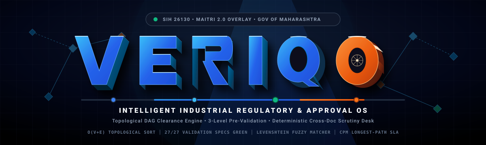

<div align="center">



### **Intelligent Industrial Regulatory, Clearance & Compliance Orchestration Engine**

[-emerald?style=for-the-badge&logo=vite)](https://github.com/harshakumar25/Veriqo)
[](https://oxc.rs)
[](./frontend/src/lib/prevalidation/demo.ts)
[%20Kahn's%20BFS-6366f1?style=for-the-badge&logo=graphql)](./frontend/src/lib/approval-graph.ts)
[](./frontend/src/lib/types.ts)
[](./LICENSE)

<p align="center">
  <b>A deterministic, graph-theoretic regulatory orchestration platform featuring a 3-tier pre-validation compiler, critical-path dependency scheduler, and synchronized dual-persona scrutiny desk for high-throughput industrial and business approvals.</b>
</p>

[Architecture & Mechanics](#-architecture--system-topology) •
[Core Modules](#-core-platform-modules) •
[Mathematical Foundations](#-mathematical-foundations--algorithms) •
[Pre-Validation Engine](#-3-tier-pre-validation-compiler) •
[Data Contracts & Storage](#-data-contracts--schema-topology) •
[Benchmark Dataset](#-canonical-industrial-benchmark-dossier) •
[Quickstart](#-quickstart-guide) •
[Live Evaluator Runbook](#-live-demonstration-runbook-3-minute-evaluator-flow)

---

</div>

## 📌 Executive Overview & Core Problem Analysis

Setting up an industrial facility, commercial warehouse, or specialized processing unit (e.g., cold storage logistics, chemical synthesis plant, engineering fabrication) requires traversing **5 to 15 statutory permits across multi-jurisdictional government bodies**—including Pollution Control, Industrial Safety & Health, Fire Services, Electricity Distribution, Local Development Authorities, and Food Safety regulators.

While conventional e-governance systems and single-window portals aggregate digital forms, they fundamentally operate as **passive, uncoordinated form repositories**. This introduces three structural clearance pathologies:

```
┌─────────────────────────────────────────────────────────────────────────────────────────────────┐
│                              THE 3 STRUCTURAL CLEARANCE PATHOLOGIES                             │
├────────────────────────────────┬────────────────────────────────┬──────────────────────────────┤
│     1. DEPENDENCY BLINDNESS    │   2. PRE-SUBMISSION VACUUM     │  3. FRAGMENTED GOVERNANCE    │
├────────────────────────────────┼────────────────────────────────┼──────────────────────────────┤
│ Permits are shown as flat,     │ Over 40% of statutory SLA time │ Site inspections occur in    │
│ unsequenced checklists. Units  │ is wasted on avoidable queries │ uncoordinated visits across  │
│ apply out-of-order (e.g.,      │ due to entity typos (PAN vs    │ separate departments. Post-  │
│ Factory License before Consent │ Allotment vs Form). Scrutiny   │ grant renewal compliance is  │
│ to Operate), triggering dead-  │ officers manually triage       │ tracked manually on static   │
│ locks and 45-120 day delays.   │ preventable documentation bugs.│ spreadsheets.                │
└────────────────────────────────┴────────────────────────────────┴──────────────────────────────┘
```

### The Veriqo Solution

**Veriqo** transforms statutory approval from a loose checklist into a **Deterministic State Machine**:

1. **Topological Sequence Enforcement**: Clearances are structured as a **Directed Acyclic Graph (DAG)** with Kahn's algorithm resolution, preventing premature filings and modeling the **Critical Path (CPM)** SLA chain.
2. **Deterministic 3-Tier Pre-Validation**: Client-side byte header validation, normalized Levenshtein cross-document consistency checks, and workflow DAG closure checks prevent incomplete or contradictory dossiers from reaching officer queues.
3. **Synchronized Dual-Persona Scrutiny Engine**: Instantaneous optimistic state updates with persistence abstraction bridge the entrepreneur portal and regulatory scrutiny desks, complete with risk triage, inline query renegotiation, and joint inspection scheduling.

---

## 🏛️ Architecture & System Topology

Veriqo follows strict **SOLID** architecture principles, decoupling presentation, domain state machines, persistence, and external services:

```mermaid
flowchart TD
    subgraph UI_TIER["1. Dual Presentation Tier"]
        E_PORTAL["Entrepreneur Workspace\n(Roadmap, Profile, Vault, Query Desk)"]
        G_DESK["Regulatory Scrutiny Desk\n(Risk Queue, Split-Screen Diff, Inspection Desk)"]
    end

    subgraph STATE_BUS["2. Reactive State & Persistence Bus (DIP)"]
        APP_PROVIDER["AppProvider & Optimistic State Bus\n(store.tsx · React Context)"]
        STORE_ABS["Storage Service Abstraction\n(LocalStorageService · IStorageService)"]
        AUDIT_SRV["Immutable Audit Log Factory\n(audit.service.ts)"]
        APP_PROVIDER <--> STORE_ABS
        APP_PROVIDER --> AUDIT_SRV
    end

    subgraph CORE_ENGINES["3. Core Computational Engines (SRP / OCP)"]
        DAG_KERNEL["Topological DAG Kernel\n(Kahn's BFS · Cycle Check · CPM Critical Path)"]
        PREVAL_COMPILER["3-Tier Pre-Validation Compiler\n(L1 Magic Bytes · L2 Fuzzy Diff · L3 DAG Closure)"]
        RULE_ENGINE["Declarative Rule Engine\n(Multi-Parameter Statutory Eligibility)"]
        REVIEW_GATES["Statutory Quality Gates Service\n(review-gates.service.ts)"]
    end

    subgraph DATA_TIER["4. Data & Service Infrastructure Tier"]
        BUSINESS_SRV["BusinessService\n(business.service.ts)"]
        APP_SRV["ApplicationService\n(application.service.ts)"]
        DOC_SRV["DocumentService\n(document.service.ts)"]
        QUERY_SRV["QueryService\n(query.service.ts)"]
        INSP_SRV["InspectionService\n(inspection.service.ts)"]
        NOTIF_SRV["NotificationService\n(notification.service.ts)"]
        PG_SCHEMA["PostgreSQL 16 Engine / Supabase Schema\n(businesses, documents, applications, queries, inspections)"]
    end

    E_PORTAL <--> APP_PROVIDER
    G_DESK <--> APP_PROVIDER
    APP_PROVIDER --> DAG_KERNEL
    APP_PROVIDER --> PREVAL_COMPILER
    APP_PROVIDER --> RULE_ENGINE
    APP_PROVIDER --> REVIEW_GATES
    APP_PROVIDER --> BUSINESS_SRV
    APP_PROVIDER --> APP_SRV
    APP_PROVIDER --> DOC_SRV
    APP_PROVIDER --> QUERY_SRV
    APP_PROVIDER --> INSP_SRV
    APP_PROVIDER --> NOTIF_SRV
    BUSINESS_SRV --> PG_SCHEMA
    APP_SRV --> PG_SCHEMA
    DOC_SRV --> PG_SCHEMA
    QUERY_SRV --> PG_SCHEMA
    INSP_SRV --> PG_SCHEMA
    NOTIF_SRV --> PG_SCHEMA
```



### Architectural Design Principles (SOLID)

- **Single Responsibility Principle (SRP)**: Each service in `src/lib/services/` encapsulates exactly one domain entity (`BusinessService`, `ApplicationService`, `DocumentService`, `QueryService`, `InspectionService`, `NotificationService`).
- **Open/Closed Principle (OCP)**: Application lifecycle states and valid statutory transitions are encapsulated in a centralized transition matrix (`ApplicationService.VALID_TRANSITIONS`), allowing state machine expansions without editing consumer components.
- **Liskov Substitution Principle (LSP)**: All storage interactions bind to `IStorageService`, enabling seamless swapping between localStorage, in-memory mocks, and remote storage providers.
- **Interface Segregation Principle (ISP)**: Custom hooks (`useVault`, `useQueries`, `useInspection`, `useBusinessProfile`) export only the minimal state slices needed by consuming views.
- **Dependency Inversion Principle (DIP)**: React components depend on high-level service interfaces rather than raw browser storage or direct external client bindings.

---

## ⚙️ Mathematical Foundations & Algorithms

### 1. Topological Prerequisite Graph Formulation

Let statutory approvals be represented as a finite directed acyclic graph:

$$\mathcal{G} = (V, E)$$

Where:
- $V = \{ v_1, v_2, \dots, v_n \}$ represents distinct statutory clearance modules.
- $E \subset V \times V$ represents statutory prerequisite constraints: $(u, v) \in E$ denotes that approval $u$ must be granted before approval $v$ may transition to `READY_TO_APPLY`.

**In-Degree Kahn's Resolution Algorithm ($O(|V| + |E|)$):**

$$\text{in\_deg}(v) = |\{ u \in V \mid (u, v) \in E \land \text{status}(u) \neq \text{'APPROVED'} \}|$$

- If $\text{in\_deg}(v) = 0 \implies \text{status}(v) \leftarrow \text{'READY\_TO\_APPLY'}$
- If $\text{in\_deg}(v) > 0 \implies \text{status}(v) \leftarrow \text{'LOCKED'}$, with the set of blocking parents:

$$\mathcal{B}(v) = \{ u \in V \mid (u, v) \in E \land \text{status}(u) \neq \text{'APPROVED'} \}$$

### 2. Critical Path Method (CPM) Dynamic SLA Scheduling

Each statutory node $v \in V$ carries an official Citizen Charter processing duration $\tau(v) \in \mathbb{N}^+$. The project duration is computed along the longest path through the weighted DAG:

$$T_{\text{CPM}} = \max_{\pi \in \Pi(v_{\text{source}}, v_{\text{sink}})} \sum_{u \in \pi} \tau(u)$$

Where $\Pi(v_{\text{source}}, v_{\text{sink}})$ denotes all valid paths from initial pre-construction clearances to operational consents. Veriqo computes Earliest Finish ($EF$) and Latest Finish ($LF$) bounds to determine the **Zero-Float Bottleneck Chain** ($TF(v) = LF(v) - EF(v) = 0$), guiding project capital planning and site staging.

### 3. Cross-Document Normalized Levenshtein Consistency

To detect discrepancies across corporate deeds, allotment letters, and tax registrations, Veriqo applies normalized Levenshtein string metrics:

$$\text{LevDist}(s_1, s_2) = \begin{cases} 
\max(|s_1|, |s_2|) & \text{if } \min(|s_1|, |s_2|) = 0, \\
\min \begin{cases} 
\text{LevDist}(\text{tail}(s_1), s_2) + 1 \\
\text{LevDist}(s_1, \text{tail}(s_2)) + 1 \\
\text{LevDist}(\text{tail}(s_1), \text{tail}(s_2)) + \mathbf{1}_{\{s_1[0] \neq s_2[0]\}}
\end{cases} & \text{otherwise.}
\end{cases}$$

$$\text{Sim}(s_1, s_2) = 1 - \frac{\text{LevDist}(\text{normalize}(s_1), \text{normalize}(s_2))}{\max(|s_1|, |s_2|)}$$

- **Blocking Threshold ($\text{Sim} < 0.90$)**: Flagged with `CRITICAL_DISCREPANCY`; submission button is locked.
- **Review Required Threshold ($0.90 \le \text{Sim} < 0.98$)**: Submission proceeds but lands in the Scrutiny Desk highlighted for officer review.

---

## 🔍 3-Tier Pre-Validation Compiler

The zero-dependency pre-validation compiler (`src/lib/prevalidation/`) executes client-side before any network payload is committed:

```
┌────────────────────────────────────────────────────────────────────────────────────────┐
│                              3-TIER PRE-VALIDATION SCANNER                             │
├────────────────────────────────────────────────────────────────────────────────────────┤
│                                                                                        │
│  [LEVEL 1: STRUCTURAL INTEGRITY]                                                       │
│   ├── Magic Header Verification: PDF ('%PDF-1.'), PNG ('\x89PNG'), JPEG ('\xFF\xD8\xFF') │
│   ├── Payload Size Bound: Max 25 MB per artifact                                       │
│   └── SHA-256 Digest Hashing: Detect duplicate or corrupted file submissions          │
│                                                                                        │
│  [LEVEL 2: CROSS-DOCUMENT CONSISTENCY & REGISTRY DIFF]                                 │
│   ├── Legal Entity Matching: Application Name vs Corporate Registry vs PAN Name       │
│   ├── Statutory Identifier Regex: GSTIN, PAN, CIN, Plot Allotment Code                 │
│   └── Capacity & Area Coherence: Sanctioned Capacity vs Detailed Flow Diagram          │
│                                                                                        │
│  [LEVEL 3: WORKFLOW DEPENDENCY & PREREQUISITE CLOSURE]                                 │
│   ├── Upstream Approval Verification: Parent clearance certificate valid on record    │
│   ├── Critical Path Impact Simulation: Warns user if filing delay impacts downstream   │
│   └── Mandatory Attachment Completeness: 100% attachment check before form submission │
│                                                                                        │
└────────────────────────────────────────────────────────────────────────────────────────┘
```

### Automated Self-Checking Test Harness (27/27 Passing Scenarios)

The engine includes an automated test harness (`src/lib/prevalidation/demo.ts`) covering structural blockers, discrepancy matrices, and recovery paths:

```bash
cd frontend && npm test
```

```text
==============================================================================
SELF-CHECK RESULTS
==============================================================================
  PASS  A1 overall status is BLOCKED
  PASS  A1 has exactly one blocking issue
  PASS  A1 blocker is a required-document issue
  PASS  A1 blocker is the Process Flow Diagram
  PASS  A1 has no discrepancies
  PASS  A1 is not submittable
  PASS  A1 FSSAI node is BLOCKED
  PASS  A1 leaves the critical path intact
  PASS  A2 overall status is READY_TO_SUBMIT
  PASS  A2 has no issues at all
  PASS  A2 has no discrepancies
  PASS  A2 is submittable
  PASS  A2 evaluated all four required documents
  PASS  A2 every required document is acceptable
  PASS  B overall status is BLOCKED
  PASS  B target node is MIDC_BUILDING_FIRE
  PASS  B produces four discrepancy rows
  PASS  B matrix contains an entity mismatch
  PASS  B matrix contains a capacity mismatch
  PASS  B matrix contains an address (plot) mismatch
  PASS  B registry inconsistency is review-required, not blocking
  PASS  B blocks the Building/Fire node
  PASS  B locks six downstream nodes
  PASS  B impacts the critical path
  PASS  B occupancy node is LOCKED
  PASS  B occupancy is locked by DISH + Final Fire prerequisites
  PASS  B leaves the independent MPCB track un-evaluated

27/27 checks passed — ALL GREEN ✅
```

---

## 🌟 Core Platform Modules

### 1. 🧭 Topological DAG Roadmap Canvas
- **Dynamic Node Evaluation**: Interactive flow canvas powered by `@xyflow/react` reflecting real-time clearance statuses (`COMPLETED`, `IN_PROGRESS`, `READY_TO_APPLY`, `LOCKED`).
- **Prerequisite Locking**: Explains exact missing parent certificates required to unlock downstream milestones.
- **Bottleneck Analysis**: Visually distinguishes critical path milestones from parallel independent tracks.

### 2. 🗄️ Canonical Reusable Document Vault
- **Single-Upload Architecture**: Upload foundational corporate deeds, land lease agreements, and site plans once; reuse them across multiple applications without duplicative uploads.
- **Verification Badging**: Tracks document verification status (`UPLOADED`, `VERIFIED`, `REJECTED`).

### 3. ⚖️ Scrutiny Desk & Explainable Risk Triage
- **Risk Classification**: Classifies dossiers into Low, Medium, and High risk based on pre-validation delta metrics and industrial classification.
- **Side-by-Side Review Matrix**: Displays extracted form values against external registry records with highlighted diffs.
- **Bidirectional Query Loop**: Enables field-specific queries and response document uploads with instant status synchronization.

### 4. 🚒 Common Inspection Desk (CIS-NX)
- **Joint Inspection Coordination**: Coordinates joint inspection windows across environmental, safety, and fire authorities.
- **Standardized Checklists**: 5-point verification checklist with digital timestamps and outcome recording (`SATISFACTORY`, `UNSATISFACTORY`, `FOLLOW_UP_REQUIRED`).

### 5. 💰 Capital Incentive Screening Engine
- **Incentive Matching**: Evaluates investment scale, taluka industrial group classification, and employment numbers against package incentive schemes.

---

## 🗄️ Data Contracts & Schema Topology

The database layer runs on PostgreSQL 16 (configured via `supabase/migrations/`) with complete referential integrity, automated timestamp triggers, and indexed foreign keys:

```sql
businesses (1) ──────────< (N) documents
    │
    ├──< (N) applications (1) ──< (N) queries ──< (1) query_responses
    │            │
    │            ├──< (N) inspections
    │            │
    │            └──< (N) application_events (Audit Timeline)
    │
    └──< (N) notifications
```

### Core Entity Contracts

| Table | Primary Responsibilities | Indexes & Constraints |
|---|---|---|
| `businesses` | Enterprise identity, location, power, water, capacity, investment parameters | `idx_businesses_sector`, `idx_businesses_user_id` |
| `documents` | Vault assets, MIME types, file sizes, verification status | `idx_documents_business_id`, `category` CHECK constraint |
| `applications` | Statutory permit instances, SLA due dates, dynamic form payloads | `idx_applications_status`, `app_number` UNIQUE |
| `application_events` | Immutable append-only audit trail capturing all actor actions | `idx_events_created_at`, `actor_role` CHECK constraint |
| `queries` | Clarification tickets raised by officers with response records | `idx_queries_application_id`, `status` CHECK constraint |
| `inspections` | Site inspection schedule, checklist JSONB, outcome records | `idx_inspections_application_id`, `outcome` CHECK constraint |
| `notifications` | Real-time action alerts and badges for applicants and officers | `idx_notifications_is_read`, `created_at DESC` |

---

## 📦 Canonical Industrial Benchmark Dossier

The platform includes a verified benchmark dataset modeled after an industrial logistics and cold-chain facility:

```yaml
Enterprise: FreshChain Cold Logistics Private Limited
Director / Applicant: Vikram Malhotra
Corporate Identity:
  CIN: U63020PN2025PTC214589
  PAN: AAACF1234K
  GSTIN: 27AAACF1234K1Z5
Facility Location:
  Industrial Area: Chakan Industrial Area Phase II, MIDC, Pune
  Plot Number: Plot No. E-45
  Built-up Area: 45,000 sq.ft on 2.5 Acres
Scale & Technical Metrics:
  Total Gross Capital Outlay: ₹15.00 Crores (MSME Medium Category)
  Proposed Direct Employment: 45 Personnel
  Refrigerated Storage Capacity: 5,000 Metric Tonnes (-25°C to +10°C)
  Connected HT Power Load: 750 kW (11 kV Feed, MSEDCL)
  Sanctioned Water Quota: 25 KLD (MIDC Network)
Primary Benchmark Application:
  Statutory License: FSSAI Central License for Cold Storage / Food Warehouse
  Application Reference ID: APP-MH-2026-00124
  Clearance Reference: APR-MH-2026-00124
Scrutiny Officer:
  Name: Rajesh Kumar (IO-MH-402)
  Designation: Designated Officer & Scrutiny Lead, Western Region
```

---

## 📂 Repository Structure

```
Veriqo/
├── assets/                                  # Extruded 3D Brand Assets & Graphics
│   └── veriqo-3d-banner.svg                 # High-resolution 3D Banner
│
├── docs/                                    # Architectural & Module Specifications
│   ├── 01_ENTREPRENEUR.md                   # Entrepreneur User Journey
│   ├── 02_BUSINESS_PROFILE_MODULE_SPEC.md   # Industrial Profile Specification
│   ├── 03_APPROVAL_INTELLIGENCE_SPEC.md     # Declarative Rule Engine Specification
│   ├── 04_PERSONALIZED_ROADMAP_SPEC.md      # Topological Graph Visualization Specification
│   ├── 06_DOCUMENT_VAULT_MODULE_SPEC.md     # Document Vault Specification
│   ├── 07_DOCUMENT_PREVALIDATION_SPEC.md    # 3-Tier Pre-Validation Specification
│   ├── 08_SUBMISSION_MODULE_SPEC.md         # Digital Submission Specification
│   ├── 09_UNIFIED_GOVERNMENT_WORKFLOW.md    # Regulatory Workflow Engine Specification
│   ├── 10_GOVERNMENT_PORTAL_SPEC.md         # Scrutiny Desk UX Specification
│   ├── 11_GOVERNMENT_REVIEW_MODULE_SPEC.md  # Split-Screen Review Specification
│   ├── 12_QUERY_MANAGEMENT_SPEC.md          # Query Management Protocol Specification
│   ├── 13_INSPECTION_MODULE_SPEC.md         # Joint Inspection Desk Specification
│   ├── 14_APPROVE_REJECT_MODULE_SPEC.md     # Statutory Grant & Rejection Specification
│   ├── 15_ENTREPRENEUR_DASHBOARD_SPEC.md    # Action-Oriented Dashboard Specification
│   ├── 16_SLA_RENEWAL_ALERTS_SPEC.md        # Statutory SLA Radar Specification
│   ├── 17_INCENTIVES_MODULE_SPEC.md         # Incentive Screening Specification
│   ├── 18_GOVERNMENT_ANALYTICS_SPEC.md      # Bottleneck Analytics Specification
│   └── PRODUCT SPECIFICATION.md             # Master Parent Specification
│
├── frontend/                                # Single-Page React Application (SOLID Architecture)
│   ├── src/
│   │   ├── components/                      # Modular UI Components
│   │   │   ├── layout/                      # Universal Navbar & Dual-Persona Navigation
│   │   │   ├── motion/                      # 3D TiltCard & RevealOnScroll Primitives
│   │   │   ├── ui/                          # Reusable Primitives (Modal, StatusBadge, RouteErrorBoundary)
│   │   │   └── ...                          # Landing page visual sections
│   │   │
│   │   ├── pages/                           # Application Pages & Personas
│   │   │   ├── LandingPage.jsx              # Landing Presentation Page
│   │   │   ├── HomePage.tsx                 # Portal Overview & Hero Section
│   │   │   ├── entrepreneur/                # Entrepreneur Workspace
│   │   │   │   ├── components/              # Sub-Form Sections & Modals (SRP)
│   │   │   │   ├── DashboardPage.tsx        # Action-First Journey Tracker
│   │   │   │   ├── BusinessProfilePage.tsx  # Industrial Entity Profile Form
│   │   │   │   ├── IntelligencePage.tsx     # Rule Engine Applicability Analysis
│   │   │   │   ├── RoadmapPage.tsx          # Interactive React Flow DAG Canvas
│   │   │   │   ├── ApplicationPage.tsx      # Application & Pre-Validation View
│   │   │   │   ├── VaultPage.tsx            # Canonical Document Vault
│   │   │   │   ├── QueryPage.tsx            # Query Negotiation Desk
│   │   │   │   └── IncentivesPage.tsx       # Capital Incentive Screening
│   │   │   │
│   │   │   └── government/                  # Regulatory Scrutiny Workspace
│   │   │       ├── components/              # Scrutiny Tabs & Dedicated Modals (SRP)
│   │   │       ├── GovDashboardPage.tsx     # Officer Queue & Simulation Controls
│   │   │       ├── ApplicationsPage.tsx     # Department Dossier Queue
│   │   │       ├── ApplicationDetailPage.tsx# Split-Screen Diff, Inspection & Decision
│   │   │       └── AnalyticsPage.tsx        # SLA Performance & Heatmap View
│   │   │
│   │   ├── lib/                             # Core Domain Engines & Services
│   │   │   ├── services/                    # Clean Service Layer (DIP / SRP)
│   │   │   │   ├── business.service.ts      # Business Entity CRUD
│   │   │   │   ├── application.service.ts   # Application State Machine
│   │   │   │   ├── document.service.ts      # Document Vault Management
│   │   │   │   ├── query.service.ts         # Query & Response Management
│   │   │   │   ├── inspection.service.ts    # Joint Inspection Desk
│   │   │   │   ├── notification.service.ts  # Notification Management
│   │   │   │   ├── storage.service.ts       # IStorageService LocalStorage Abstraction
│   │   │   │   ├── audit.service.ts         # Immutable Audit Event Factory
│   │   │   │   └── review-gates.service.ts  # Statutory Quality Gates Evaluator (OCP)
│   │   │   ├── hooks/                       # Domain-Scoped Segregated Hooks (ISP)
│   │   │   ├── approval-graph.ts            # DAG Nodes, Topological Sort & Dependencies
│   │   │   ├── rule-engine.ts               # Declarative Rule Evaluation Matrix
│   │   │   ├── store.tsx                    # Optimistic React Context State Bus
│   │   │   ├── types.ts                     # Strict TypeScript Data Interfaces
│   │   │   ├── supabase.ts                  # Supabase Client & Graceful Offline Fallback
│   │   │   ├── data/hero-data.ts            # FreshChain Verified Reference Data
│   │   │   └── prevalidation/               # Zero-Dependency 3-Level Pre-Validation Engine
│   │   │
│   │   ├── App.tsx                          # Client-Side Routing Hierarchy
│   │   └── main.tsx                         # Mount Point & State Reset Boundary
│   │
│   ├── package.json                         # Dependencies & Scripts
│   └── vite.config.ts                       # Vite Bundler Configuration
│
├── supabase/                                # Relational PostgreSQL Database
│   └── migrations/
│       ├── 001_initial_schema.sql           # Schema with Indexes, Triggers, CHECK constraints & RLS
│       └── 002_seed_data.sql                # Complete Industrial Benchmark Seed
│
├── .env.example                             # Environment Configuration Template
├── package.json                             # Root Workspace Configuration
└── README.md                                # Master Technical Documentation
```

---

## ⚡ Quickstart Guide

### Prerequisites
- **Node.js**: v18.0.0 or higher (`node -v`)
- **npm**: v9.0.0 or higher (`npm -v`)

### 1. Installation
Clone the repository and install all dependencies:

```bash
git clone https://github.com/harshakumar25/Veriqo.git
cd Veriqo
npm install
cd frontend && npm install && cd ..
```

### 2. Run the Verification Test Suite
Execute the 27-scenario mathematical test harness:

```bash
cd frontend && npm test
```

### 3. Run Quality Linters
Ensure zero warnings and zero errors across all codebase rules:

```bash
cd frontend && npm run lint
```

### 4. Start the Development Server
Launch the interactive web application:

```bash
cd frontend && npm run dev
```

Open your browser at: **[http://localhost:5173](http://localhost:5173)**

### 5. Build for Production
Generate an optimized, tree-shaken static production bundle:

```bash
cd frontend && npm run build
```

---

## 🎬 Live Demonstration Runbook (3-Minute Evaluator Flow)

Follow this sequence to review the end-to-end regulatory approval lifecycle:

### Step 1: Entrepreneur Profile & Rule Analysis (0:00 – 0:45)
1. Open `http://localhost:5173/` and navigate to **"Start as Entrepreneur"** (or `/entrepreneur/business-profile`).
2. Review the pre-loaded **20-parameter industrial profile** for *FreshChain Cold Logistics Pvt. Ltd.* (MIDC Chakan Phase II, 5,000 MT capacity, 750 kW power).
3. Click **"Analyze Regulatory Requirements"** $\to$ the **Declarative Rule Engine** evaluates statutory parameters and determines all applicable clearances across pre-construction, construction, and operational phases.

### Step 2: Topological DAG Roadmap (0:45 – 1:30)
1. Navigate to **"My Roadmap"** (`/entrepreneur/roadmap`).
2. Interact with the **Topological DAG Canvas**:
   - Upstream permits (Land Allotment, Building Plan Sanction, Consent to Establish) are sequenced first.
   - Click **FSSAI Central Licence** $\to$ view statutory drawer with legal citations, mandatory documents, and SLA days.
   - Observe that downstream permits (Factory License, Occupancy Certificate) remain `LOCKED 🔒` with clear indications of which antecedent permits must be cleared first.

### Step 3: Pre-Validation Scan & Blocker Demonstration (1:30 – 2:15)
1. Navigate to the FSSAI Application (`/application/app-hero-fssai-01` or `/application/app-hero-00124`).
2. Click **"Run Pre-Validation Scan"**:
   - The engine highlights missing mandatory attachments (e.g. *Process Flow Diagram*) with actionable recovery steps.
   - The submission button is protected until all blocking checks clear.
3. Attach verified documents from the **Canonical Document Vault** (`/vault`) $\to$ Pre-Validation clears with green checkmarks $\to$ Submit the application.

### Step 4: Regulatory Scrutiny Desk & Approval (2:15 – 3:00)
1. Switch to the **"Government Officer"** persona (*Rajesh Kumar, Scrutiny Lead*).
2. On the **Scrutiny Desk** (`/government/dashboard`), observe the dossier categorized by pre-validation risk tier.
3. Use the **Interactive Officer Simulation Bar** or detailed application view:
   - **Cross-Doc Consistency**: Review entity consistency against official records.
   - **Query Resolution**: Inspect applicant responses and revised file attachments.
   - **Joint Inspection Desk**: Review on-site inspection findings and 5-point statutory checklist verification.
   - Execute final approval $\to$ certificate reference `APR-MH-2026-00124` is issued, instantly updating compliance and renewal alerts on the Entrepreneur's live dashboard.

---

## 📄 License & Open Source Attribution

Veriqo is open-source software licensed under the **MIT License**. See [LICENSE](./LICENSE) for details.

<div align="center">
  <sub>Designed and engineered for high-assurance industrial compliance, transparent governance, and accelerated enterprise setup.</sub>
</div>
